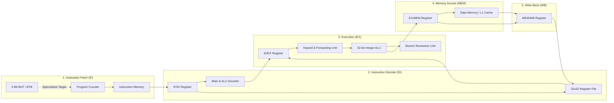
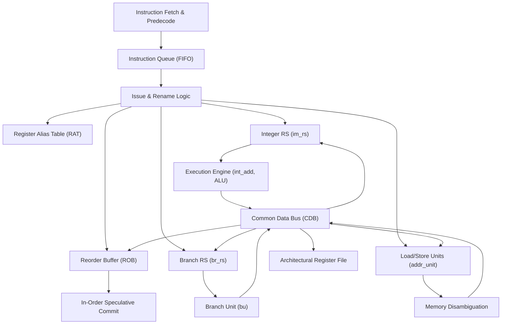

# 32-Bit Superscalar & Out-of-Order Processor Architecture
### Progressive Microarchitecture: From Single-Cycle Baseline to Tomasulo OoO & SIMD Vector Acceleration

[](https://en.wikipedia.org/wiki/Verilog)
[](https://github.com/google/skywater-pdk)
[](http://iverilog.icarus.com/)
[](https://yosyshq.net/yosys/)
[](#-v5-out-of-order-execution-engine-tomasulo--rob)
[](LICENSE)

---

## 📌 Architectural Overview

This repository hosts a fully modular, synthesizable **32-Bit Microprocessor Core** modeled in Verilog HDL. Designed to bridge academic computer architecture theory (*Hennessy & Patterson: Computer Architecture — A Quantitative Approach*) and industry-standard digital ASIC design, the core demonstrates an end-to-end evolutionary progression across **six microarchitectural generations**:

```
[V1: Single-Cycle] ──> [V2: 5-Stage Pipeline] ──> [V3: Hazard & Forwarding]
                                                          │
[V6: DLP SIMD + L1 Cache] <── [V5: Tomasulo OoO + ROB] <── [V4: Dynamic Branch Predictor]
```

1. **V1 — Single-Cycle Baseline Core**: Unpipelined Harvard architecture establishing baseline CPI = 1.0 (long critical path through Instruction Memory, Decode, ALU, Data Memory, and Register File).
2. **V2 — Classical 5-Stage RISC Pipeline**: Decoupled `IF`, `ID`, `EX`, `MEM`, and `WB` stages isolated by synchronous pipeline registers to slash critical path delay and maximize operating frequency.
3. **V3 — Control Hazard Resolution & Bypassing**: Full hazard detection and data forwarding network resolving Read-After-Write (RAW) dependencies with zero-penalty forwarding and single-cycle load-use interlocks.
4. **V4 — Dynamic Speculative Branch Execution**: 2-Bit Saturating Counter Branch History Table (BHT) coupled with a Branch Target Buffer (BTB) to minimize branch penalty on conditional control flow.
5. **V5 — Out-of-Order (OoO) Superscalar Engine**: Dynamic execution engine based on the **Tomasulo Algorithm** featuring an Instruction Queue (IQ), distributed Reservation Stations (RS), Register Renaming via Register Alias Table (RAT), Common Data Bus (CDB), and a Reorder Buffer (ROB) guaranteeing in-order speculative retirement.
6. **V6 — Data-Level Parallelism (DLP) & Memory Subsystem**: Sub-word SIMD arithmetic execution units (`addb`, `addh`, `subb`, `subh`), dedicated SIMD decoding/issue logic, and an integrated Direct-Mapped L1 Data Cache (`dm_cache.v`) with tag checking and hit/miss penalty handling.

---

## 🏛️ Microarchitectural Evolution Trajectory

| Generation | Execution Paradigm | Data Hazard Strategy | Control Hazard Strategy | Memory Subsystem | Key RTL Modules |
| :--- | :--- | :--- | :--- | :--- | :--- |
| **V1** | Single-Cycle In-Order | Combinational settling | Single-cycle PC evaluation | Flat synchronous SRAM | `alu_behaviour.v`, `reg_file.v`, `pc.v` |
| **V2** | 5-Stage Classic Pipeline | None (Software NOPs) | Static stall bubbles | Split I/D Memory | `if_id.v`, `id_ex.v`, `ex_mem.v`, `mem_wb.v` |
| **V3** | 5-Stage Hazard-Resolved | EX/MEM & MEM/WB Bypassing | Load-use interlock stall | Split I/D Memory | `fwd_unit.v`, `stall_unit.v` |
| **V4** | Speculative 5-Stage | Data forwarding network | 2-Bit BHT + Branch Target Buffer | Speculative fetch flush | `bht.v`, `bu.v`, `budecoder.v`, `jdecoder.v` |
| **V5** | Out-of-Order (Tomasulo) | Register Renaming + CDB | Branch RS + Speculative ROB | In-order Store Commit | `rob.v`, `reservation_station.v`, `im_rs.v`, `br_rs.v`, `issue_logic.v` |
| **V6** | **OoO + DLP Vector Engine** | Vector lane isolation | Speculative retirement | **L1 Direct-Mapped Cache** | `simd_decoder.v`, `simd_issue.v`, `addb.v`, `addh.v`, `subb.v`, `subh.v`, `dm_cache.v` |

---

## 🏗️ Detailed Microarchitectural Stages

### 1. Classical 5-Stage In-Order Pipeline (V2 – V4)

The in-order core implements a synchronized 5-stage pipeline with strict phase isolation:



#### Hazard Mitigation & Forwarding Logic:
* **EX-to-EX Forwarding**: Bypasses the ALU output from `EX/MEM` directly into ALU inputs of `ID/EX` when:
  $$\text{ForwardA/B} = 10 \iff (\text{EX/MEM.RegWrite} \land (\text{EX/MEM.RegisterRd} \neq 0) \land (\text{EX/MEM.RegisterRd} == \text{ID/EX.RegisterRs/Rt}))$$
* **MEM-to-EX Forwarding**: Bypasses write-back data from `MEM/WB` into `ID/EX` execute operands when earlier stages do not override.
* **Load-Use Interlock**: Inserts a hardware stall bubble into `IF/ID` and holds the `PC` when a load destination matches an immediate consumer's source register:
  $$\text{Stall} \iff (\text{ID/EX.MemRead} \land ((\text{ID/EX.RegisterRt} == \text{IF/ID.RegisterRs}) \lor (\text{ID/EX.RegisterRt} == \text{IF/ID.RegisterRt})))$$

---

### 2. Speculative Branch Prediction Unit (V4)

To prevent pipeline flushes on conditional branches, a **2-Bit Saturating Counter Predictor** operates in parallel with the instruction fetch stage:

```
          Taken (1)                     Taken (1)
       ┌──────────────┐              ┌──────────────┐
       │              ▼              │              ▼
    ┌─────┐        ┌─────┐        ┌─────┐        ┌─────┐
    │ 00  │        │ 01  │        │ 10  │        │ 11  │
    │ SN  │        │ WN  │        │ WT  │        │ ST  │
    └─────┘        └─────┘        └─────┘        └─────┘
       ▲              │              ▲              │
       └──────────────┘              └──────────────┘
         Not Taken (0)                 Not Taken (0)
```

* **States**:
  * `00` (**SN** - Strongly Not Taken): Predict Not Taken.
  * `01` (**WN** - Weakly Not Taken): Predict Not Taken.
  * `10` (**WT** - Weakly Taken): Predict Taken.
  * `11` (**ST** - Strongly Taken): Predict Taken.
* **Branch Target Buffer (BTB)**: Caches target branch addresses. A cache hit allows target fetching in the very next cycle, eliminating pipeline bubbles.
* **Misprediction Recovery**: On an evaluation mismatch in the `EX` stage, the mispredicted speculative instructions in `IF/ID` are flushed, the correct sequential/branch PC is restored, and the BHT counter is decremented/incremented.

---

### 3. Out-of-Order Execution Engine: Tomasulo Algorithm & ROB (V5)

The Out-of-Order execution core dynamically extracts Instruction-Level Parallelism (ILP) by executing instructions as soon as operands are available, eliminating Write-After-Read (WAR) and Write-After-Write (WAW) false dependencies through register renaming.



#### Key Microarchitectural Components:
1. **Instruction Queue (`intruction_queue.v`)**: Decouples in-order instruction fetch from the dispatch and reservation logic.
2. **Register Renaming / RAT**: Maps architectural registers ($R_0 - R_{31}$) to speculative tags (ROB/RS entry IDs), converting anti-dependencies into direct value routing.
3. **Distributed Reservation Stations (`im_rs.v`, `br_rs.v`, `reservation_station.v`)**:
   * Hold instruction operation codes and operands.
   * Snoop the Common Data Bus (CDB) for matching producer tags ($Q_j, Q_k$).
   * Wake up immediately when all required source values ($V_j, V_k$) are available.
4. **Common Data Bus (CDB)**: High-speed broadcast network that broadcasts the tuple `{Tag, Value}` across all reservation stations, ROB entries, and register files simultaneously.
5. **Reorder Buffer (`rob.v`)**:
   * Circular FIFO queue tracking all instructions in-flight.
   * Guarantees precise exceptions and safe speculative execution by strictly enforcing **in-order retirement** to the architectural register file.

---

### 4. Data-Level Parallelism (DLP) & Sub-Word SIMD Extensions (V6)

To accelerate multimedia, DSP, and matrix computing workloads, the execution stage is augmented with a dedicated **Sub-word SIMD Vector Engine**. A single 32-bit register is sliced into independent parallel data lanes:

```
32-Bit Vector Register Slicing:

4x 8-Bit Packed SIMD (Byte Mode):
┌──────────────┬──────────────┬──────────────┬──────────────┐
│  Byte 3      │  Byte 2      │  Byte 1      │  Byte 0      │
│  [31:24]     │  [23:16]     │  [15:8]      │  [7:0]       │
└──────────────┴──────────────┴──────────────┴──────────────┘

2x 16-Bit Packed SIMD (Half-Word Mode):
┌─────────────────────────────┬─────────────────────────────┐
│  Half-Word 1                │  Half-Word 0                │
│  [31:16]                    │  [15:0]                     │
└─────────────────────────────┴─────────────────────────────┘
```

#### SIMD Instruction Set Additions:
* **`addb` (`addb.v`)**: 4-way parallel 8-bit addition with carry containment across byte boundaries:
  $$\text{Rd}[7:0] = \text{Rs}[7:0] + \text{Rt}[7:0]$$
  $$\text{Rd}[15:8] = \text{Rs}[15:8] + \text{Rt}[15:8]$$
  $$\text{Rd}[23:16] = \text{Rs}[23:16] + \text{Rt}[23:16]$$
  $$\text{Rd}[31:24] = \text{Rs}[31:24] + \text{Rt}[31:24]$$
* **`addh` (`addh.v`)**: 2-way parallel 16-bit addition with independent half-word overflow boundaries.
* **`subb` (`subb.v`)**: 4-way parallel 8-bit vector subtraction.
* **`subh` (`subh.v`)**: 2-way parallel 16-bit vector subtraction.
* **`simd_decoder.v` & `simd_issue.v`**: Identifies vector opcodes from the instruction stream and routes packed operands directly into the vector execution ALUs.

---

### 5. Memory Hierarchy & L1 Direct-Mapped Cache (`dm_cache.v`)

The core integrates a dedicated synthesizable **Direct-Mapped L1 Cache** subsystem to bridge the processor-memory frequency gap:

```
32-Bit Memory Address Breakdown:
┌──────────────────────────────┬──────────────────┬──────────────┐
│           TAG                │      INDEX       │    OFFSET    │
│         [31:10]              │      [9:4]       │    [3:0]     │
└──────────────────────────────┴──────────────────┴──────────────┘
               │                         │
               │ Tag Comparator          │ Line Select (64 sets)
               ▼                         ▼
        ┌──────────────┐          ┌──────────────┐
        │ Tag Match?   │<─────────┤ Cache SRAM   │
        └──────┬───────┘          └──────────────┘
               │
      Hit / Miss Evaluation
```

* **Cache Architecture**: Direct-mapped, write-through / write-back configurable.
* **Tag & Valid Arrays**: Compares memory address tag against cached tag on every load/store request.
* **Hit/Miss Control**:
  * **Hit**: Zero-wait-state data delivery to the pipeline/ROB.
  * **Miss**: Asserts a pipeline stall/wait signal, fetches a cache line from main memory, updates tag and data arrays, and resumes execution.

---

## 📂 RTL Module Directory & Architecture Mapping

The repository's `rtl/` directory is structured into specialized functional subsystems:

```
rtl/
├── Core & Single-Cycle Baseline
│   ├── top.v                    # Top-level SoC / Core wrapper
│   ├── pc.v, prog_counter.v     # Program Counter register logic
│   ├── pc_adder.v               # Sequential PC increment adder
│   ├── reg_file.v               # 32x32-bit Dual-Read Single-Write Register File
│   ├── alu_behaviour.v          # 32-bit Integer Arithmetic Logic Unit
│   ├── alu_decoder.v            # ALU operation function decoder
│   ├── main_decoder.v           # Main opcode control generator
│   ├── control_unit.v           # Unified instruction decoding unit
│   ├── sign_extend.v, l_shift.v # Immediate sign extension & shifter logic
│   ├── ins_mem.v, data_mem.v    # Synthesizable behavioral memory models
│   └── tmux.v, mux_32.v, p_mux.v, operandmux.v # Multiplexing and datapath steering
│
├── Pipeline Registers & Hazard Management (V2 - V3)
│   ├── if_id.v                  # Fetch / Decode pipeline barrier
│   ├── id_ex.v                  # Decode / Execute pipeline barrier
│   ├── ex_mem.v                 # Execute / Memory pipeline barrier
│   ├── mem_wb.v                 # Memory / Write-back pipeline barrier
│   ├── fwd_unit.v               # EX/MEM & MEM/WB Data Forwarding Engine
│   └── stall_unit.v             # Load-use hazard detector & pipeline stall unit
│
├── Dynamic Branch Prediction (V4)
│   ├── bht.v                    # 2-Bit Saturating Counter Branch History Table
│   ├── bu.v                     # Dedicated branch execution unit
│   ├── budecoder.v              # Branch condition instruction decoder
│   ├── jdecoder.v               # Jump target calculation logic
│   └── sbr_unit.v               # Speculative branch resolution unit
│
├── Tomasulo Out-of-Order Engine (V5)
│   ├── intruction_queue.v       # Decoupling instruction issue FIFO
│   ├── issue_logic.v            # Instruction issue, renaming & RS dispatch
│   ├── reservation_station.v    # Parameterized reservation station entry
│   ├── im_rs.v                  # Integer/Immediate reservation station pool
│   ├── br_rs.v                  # Branch prediction reservation station pool
│   ├── int_add.v                # Pipelined integer execution adder
│   ├── addr_unit_ld.v           # Effective address generator for loads
│   ├── addr_unit_sw.v           # Effective address generator for stores
│   ├── lb.v, sb.v               # Sub-word load-byte / store-byte logic
│   └── rob.v                    # Reorder Buffer for in-order commit
│
└── DLP SIMD Vector Engine & Cache (V6)
    ├── simd_decoder.v           # SIMD vector instruction decoder
    ├── simd_issue.v             # SIMD vector dispatch & issue logic
    ├── addb.v                   # 4x 8-bit packed vector addition
    ├── addh.v                   # 2x 16-bit packed vector addition
    ├── subb.v                   # 4x 8-bit packed vector subtraction
    ├── subh.v                   # 2x 16-bit packed vector subtraction
    └── dm_cache.v               # Direct-Mapped L1 Data Cache
```

---

## ⚙️ Microarchitectural Specifications

| Parameter | Specification | Notes |
| :--- | :--- | :--- |
| **ISA Architecture** | 32-bit RISC / MIPS-32 Base + Custom Sub-Word SIMD | R-type, I-type, J-type, Vector SIMD |
| **Datapath Width** | 32-bit Data / 32-bit Byte-Addressable Address | Direct byte and half-word support |
| **Pipeline Stages** | 5 Stages (`IF`, `ID`, `EX`, `MEM`, `WB`) | In-order mode baseline |
| **Execution Paradigm** | Dual-mode: In-Order 5-Stage / Tomasulo Out-of-Order | Configurable via top-level parameterization |
| **Branch Predictor** | 2-Bit Saturating Counter BHT + Speculative BTB | Flushes speculative instructions on mispredict |
| **Out-of-Order Hardware** | Instruction Queue + RS + ROB + CDB | Eliminates WAR/WAW dependencies |
| **Vector SIMD Units** | 4-Lane Byte (`addb`/`subb`), 2-Lane Half-word (`addh`/`subh`) | Carry-isolated sub-word execution |
| **Memory Subsystem** | Direct-Mapped L1 Cache (`dm_cache.v`) | Integrated tag matching & hit/miss line fill |
| **Target PDK** | SkyWater 130nm High-Density (`sky130_fd_sc_hd`) | Synthesized via open-source Yosys toolchain |

---

## 🧪 Simulation, Verification & Waveform Analysis

The core is verified across all evolutionary stages using comprehensive Verilog testbenches simulated with **Icarus Verilog** and inspected using **GTKWave**.

### Verification Workflow

```bash
# 1. Clone the repository
git clone https://github.com/shausindustries/Mips_32_processor.git
cd Mips_32_processor

# 2. Compile the top-level processor with testbench
iverilog -g2012 -o sim/core_sim.vvp rtl/*.v tb/tb_top.v

# 3. Execute behavioral simulation
vvp sim/core_sim.vvp

# 4. Launch GTKWave to view pipeline transitions and waveform dumps
gtkwave sim/waveform.vcd
```

### Verified Testbench Scenarios
* **Arithmetic & Logic Completeness**: Comprehensive coverage of ALU operations, immediate sign extension, and shift logic.
* **Hazard & Forwarding Correctness**: Verification of consecutive back-to-back dependent arithmetic operations validating EX-to-EX and MEM-to-EX forwarding paths.
* **Load-Use Interlocks**: Injected load followed immediately by consumer verifying that the pipeline inserts exactly one stall bubble without data corruption.
* **Branch Speculation & Recovery**: Tested loops and alternating conditional branches validating BHT state machine transitions and flush penalties.
* **Tomasulo OoO Dynamic Scheduling**: Verified dependency chains with long-latency operations where independent instructions bypass stalled instructions and commit in-order via the ROB.
* **SIMD Sub-word Vector Math**: Verified 8-bit and 16-bit packed additions and subtractions across extreme boundary values (`0xFF + 0x01` ensuring carry containment).
* **L1 Cache Hits & Misses**: Verified memory access sequences confirming cache hit latency, compulsory cold misses, and correct dirty-line handling.

---

## 🔬 ASIC Synthesis & Physical Design Flow

The RTL is engineered to be fully synthesizable for standard-cell ASIC implementation using open-source EDA tools.

```
                  ┌──────────────────────┐
                  │ Verilog RTL (rtl/*.v)│
                  └──────────┬───────────┘
                             │
                             ▼
                  ┌──────────────────────┐
                  │ Yosys Open Synthesis │ <── SkyWater 130nm Liberty (.lib)
                  └──────────┬───────────┘
                             │
                             ▼
                  ┌──────────────────────┐
                  │ Gate-Level Netlist   │
                  └──────────┬───────────┘
                             │
                             ▼
                  ┌──────────────────────┐
                  │ OpenLane / OpenROAD  │ <── LEF, Tech-LEF, SDC Constraints
                  │ Floorplan, PnR, CTS  │
                  └──────────┬───────────┘
                             │
                             ▼
                  ┌──────────────────────┐
                  │ GDSII Silicon Layout │
                  └──────────────────────┘
```

### Synthesis Execution (Yosys)

```bash
# Synthesize RTL targeting SkyWater 130nm library
yosys -p "read_verilog rtl/*.v; synth -top top; dfflibmap -liberty sky130_fd_sc_hd.lib; abc -liberty sky130_fd_sc_hd.lib; clean; write_verilog synth/gate_netlist.v; stat -liberty sky130_fd_sc_hd.lib"
```

---

## 📖 References & Theoretical Foundation

1. **Hennessy, J. L., & Patterson, D. A.** *Computer Architecture: A Quantitative Approach* (6th Edition). Morgan Kaufmann.
2. **Tomasulo, R. M. (1967).** *An Efficient Algorithm for Exploiting Multiple Arithmetic Units*. IBM Journal of Research and Development, 11(1), 25-33.
3. **Smith, J. E. (1981).** *A Study of Branch Prediction Strategies*. Proceedings of the 8th Annual Symposium on Computer Architecture (ISCA).
4. **SkyWater Technology & Google.** *SkyWater 130nm PDK Open-Source Documentation*.

---

## 👨‍💻 Author

**Shaurya**
* **GitHub**: [@shausindustries](https://github.com/shausindustries)
* **Specialization**: Computer Architecture, RTL Design, Digital IC Design & ASIC Verification
